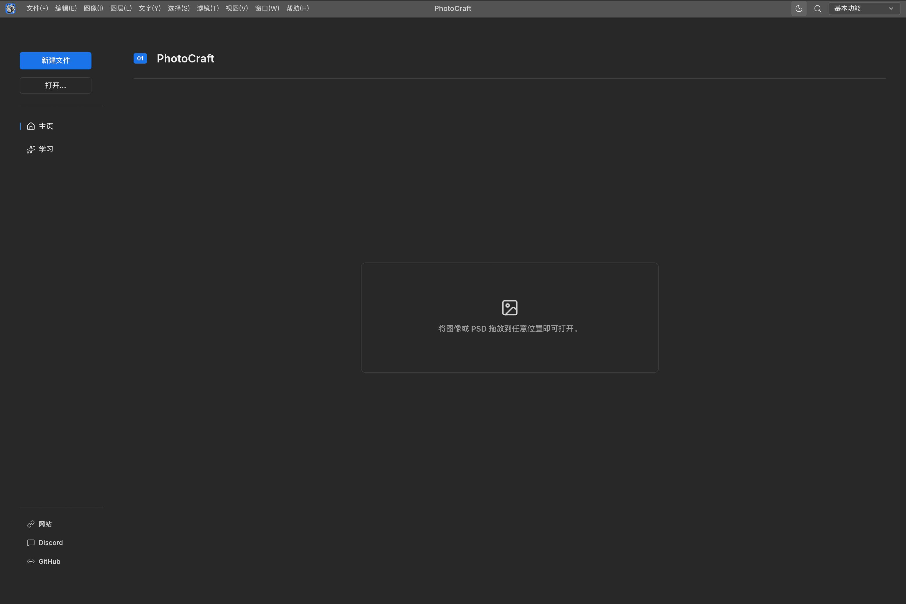

# 照片工坊 · PhotoCraft for HarmonyOS
### 本程序完全由AI（DeepSeek-V4.1-flash）移植。测试由本人完成，难免存在疏漏，敬请谅解。

[PhotoCraft](https://github.com/storytold/photocraft) 是开源的桌面图像编辑器（Rust + egui + wgpu）。
这是它的鸿蒙原生移植：引擎交叉编译成 `.so`，跑在 XComponent 的 surface 上，界面由引擎自己绘制 ——
没有 ArkUI 页面，也没有 Web 容器。



## 这是什么

工具、图层、画笔、对话框全都是上游那一套代码，移植层只负责四件事：
把渲染挂到鸿蒙的窗口上、把触摸/鼠标/键盘翻译成引擎的输入事件、把「打开文件 / 保存文件 / 打开链接」、进行汉化。
当前基于上游 **v0.23.1**。

## 功能

图层与蒙版、混合模式、画笔 / 橡皮 / 渐变 / 文字 / 形状、选区与裁剪、色彩调整、滤镜、PSD 打开，
导出 PNG / JPEG / PSD。

## 环境要求

| | |
|---|---|
| 运行 | HarmonyOS 5.0（API 12）及以上，平板或 2in1 |
| 构建 | DevEco Studio + HarmonyOS SDK API 26、Rust 1.95 或更新、鸿蒙 NDK |
| 额外 | 上游 PhotoCraft 源码、[craft-i18n](https://github.com/storytold/craft-i18n) 语言包 |

## 构建与安装

仓库里不含引擎二进制（`.so` 约 84 MB），需要自己编一次。

**1. 取源码**

```bash
git clone https://github.com/HM-U3/photocraft-harmonyos.git
# 引擎：storytold/photocraft 的 v0.23.1
# 语言包：storytold/craft-i18n，提交号见上游仓库的 craft-i18n.rev
```

**2. 编引擎并投放**

```bash
export OHOS_SDK="/path/to/DevEco Studio/sdk/default/openharmony"
export CRAFT_I18N_DIR="/path/to/craft-i18n"
bash tools/build_engine_native/build_ohos.sh /path/to/photocraft --hap
```

`--hap` 表示投放 `.so` 之后再跑一次 hvigor 打包；不带就只编库。`CRAFT_I18N_DIR` 别漏，
没有它编译照样成功，但界面只有英文。SDK 路径里带空格会让 `--sysroot` 被切开，先建一个无空格的
目录联接指过去再设 `OHOS_SDK`。

**3. 装到设备**

```bash
# 仓库不带签名材料：用你自己的证书填 build-profile.json5 的 signingConfigs
hdc install -r entry/build/default/outputs/default/entry-default-signed.hap
```

也可以直接用 DevEco Studio 打开工程、选设备运行。脚本默认只出 arm64；模拟器是 x86_64，
需要自己加 `--target x86_64-unknown-linux-ohos` 再编一份。

## 交互

鼠标、触控笔、触控板都能用，快捷键沿用桌面版：`B` 画笔、`E` 橡皮、`V` 移动、`Ctrl` + 滚轮缩放、
空格临时抓手。触控板上双指捏合也能缩放。

## 已知限制

- 从文件管理器「用其他应用打开」还没接，打开文件请走应用内「文件 → 打开」。
- 滚轮依赖 `onAxisEvent`（API 17），HarmonyOS 5.0（API 12~16）的设备上滚不动，指触不受影响。

## 许可

MIT OR Apache-2.0，任选其一，见 `LICENSE-MIT` / `LICENSE-APACHE`。
上游署名、字体来源与第三方依赖说明在 `NOTICE`。本项目是社区移植，与上游团队无关。

移植记录、踩过的坑写在 [`docs/technical-notes.md`](docs/technical-notes.md)。
