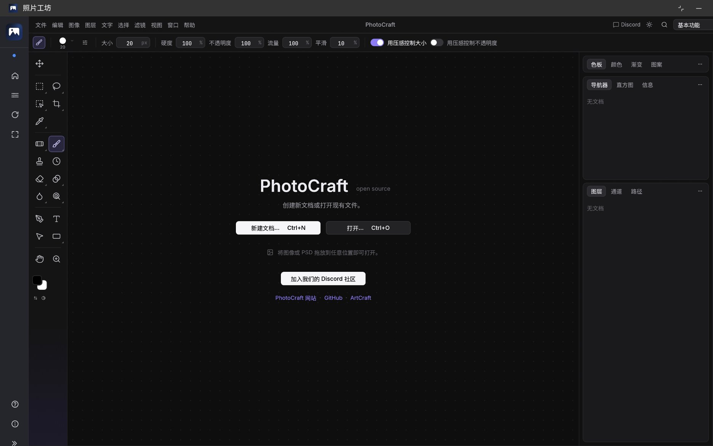

# 照片工坊 · PhotoCraft for HarmonyOS

> 把开源图像编辑器 **[PhotoCraft](https://github.com/storytold/photocraft)**（Rust / egui / wgpu）
> **原生**移植到 **HarmonyOS 5+**：引擎编译成 aarch64 原生库，wgpu 经 EGL/GLES
> 直接渲染进 `XComponent`，**不经过 ArkWeb、没有 WebAssembly、没有 HTML** ——
> 鸿蒙平板与鸿蒙电脑（2in1）都可用，界面为简体中文。

<p align="center">
  
</p>

<p align="center"><sub>鸿蒙电脑（2in1）上的主界面 · 整个界面由引擎自己绘制</sub></p>

---

## 一、这是什么

- **上游**：PhotoCraft 是一个用 Rust 编写的开源图像编辑器，`egui` 负责界面、`wgpu` 负责绘制，
  功能面向 Photoshop 类工作流（图层、选区、路径、滤镜等）。上游目前仍处于 **early alpha**。
- **本工程**：上游引擎的**鸿蒙原生宿主**。`libphotocraft_native.so` 编译成
  `aarch64-unknown-linux-ohos`，在自己的线程里跑 egui + wgpu，把画面直接画进
  `XComponent` 的 surface；ArkTS 这一层只做「系统能力代理」——触摸 / 鼠标 / 键盘 / 滚轮的转发、
  输入法、系统文件选择器、打开外链。
- **中文化**：引擎自带上游的 `zh-hans` 词条表，默认语言即简体中文。
  中文字形取自**系统字体**（HarmonyOS Sans SC / Noto Sans CJK），不额外打包字体文件。
- **打开即全屏**：电脑 / 平板电脑模式下启动直接铺满整屏（沉浸式，标题栏与 Dock 光标移到
  屏幕顶边才浮出）。窗口在加载界面**之前**就切好，`XComponent` 的 surface 一落地就是整屏尺寸，
  不会出现「先缩在中间、再撑大」的那一帧。

> **非官方适配**
>
> 本工程与上游 PhotoCraft / ArtCraft 团队**没有隶属或背书关系**，是第三方移植。
> 上游本身仍是 early alpha（原作者对其日常可用度的评估约为 Photoshop 的 25%~35%），
> **请勿用于生产工作流**。

### 与 1.x 的区别

1.x 走的是「`photocraft-web` 编译成 24.5 MB 的 WebAssembly → ArkWeb 加载 → 自定义 HTML 外壳」，
需要 Git LFS，且处处受 Web 组件限制（渲染后端、输入延迟、字体、文件对话框都得绕）。
2.0 起改为原生：**同一个 `egui` 界面直接画在系统 surface 上**，输入与系统能力直连。

| | 1.x（WebAssembly） | 2.0（原生，本仓库当前状态） |
|---|---|---|
| 引擎形态 | `.wasm` + JS 胶水层，24.5 MB | `libphotocraft_native.so`，约 74 MB（HAP 内 63 MB） |
| 承载方式 | ArkWeb + 自定义 `index.html` | `XComponent` surface + wgpu |
| 渲染后端 | WebGL2 / WebGPU / CPU（浏览器三选一） | wgpu 的 GLES（EGL）后端 |
| 输入 | DOM 事件 | ArkTS 事件 → NAPI → egui `RawInput` |
| 界面外壳 | ArkTS 侧栏 / 顶栏 / 底栏 | 引擎自己的菜单栏与面板（与桌面版一致） |
| 字体 | 内嵌 Noto Sans SC 子集 | 系统字体 |
| 仓库体积 | 需要 Git LFS | 引擎不入库，clone 只有几百 KB |

## 二、功能

| 类别 | 说明 |
|---|---|
| 编辑能力 | 图层、选区、画笔、橡皮、填充、渐变、文字、形状、变换、滤镜、路径等，与上游桌面版一致 |
| 文件 | 新建 / 打开 `.pcraft` 文档；可导入 PNG、JPG 以及 PSD（栅格化） |
| 保存导出 | 「存储为」走系统文件选择器；同一文件第二次保存不再弹框 |
| 输入方式 | 鼠标、触摸、手写笔（支持压感控制笔刷大小与不透明度） |
| 键盘 | 完整快捷键（`Ctrl+N` 新建、`Ctrl+O` 打开、`Ctrl+S` 保存、`Ctrl+Z` 撤销等） |
| 界面语言 | 简体中文（上游 `zh-hans` 词条），可在「首选项 › 界面 › 语言」切换 |

## 三、环境要求

| 项 | 要求 |
|---|---|
| 目标系统 | HarmonyOS 5.0（API 12）及以上 |
| 设备类型 | `phone` / `tablet` / `2in1` |
| 开发工具 | DevEco Studio 6.1.1（hvigor 6.24.4 下验证通过） |
| 第三方依赖 | 无，`oh-package.json5` 为空，Sync 不需要联网装包 |
| 引擎二进制 | **不在本仓库**（74 MB，`**/libs/` 已忽略），见 §四.2 |
| 不需要 | Git LFS、Node / Python 工具链、任何本地服务 |

## 四、快速开始

### 1. 获取代码

```bash
git clone https://github.com/HM-U3/photocraft-harmonyos.git photo
cd photo
```

仓库里没有几十 MB 的二进制，clone 很快。**但此时还不能装机** —— 缺 `entry/libs/arm64-v8a/libphotocraft_native.so`
的工程可以正常 Sync、也能通过编译检查，运行时会停在「原生渲染启动失败」。补齐方式见下一节。

### 2. 引擎二进制从哪来

引擎源码是上游 PhotoCraft 的 Rust workspace（**不在本仓库**），加上鸿蒙移植所需的改动后交叉编译得到：

```bash
export OHOS_NDK_HOME="D:/DevEco Studio/sdk/default/openharmony"     # 换成你的路径
export NDK="$OHOS_NDK_HOME/native"
export CC_aarch64_unknown_linux_ohos="$NDK/llvm/bin/clang"
export AR_aarch64_unknown_linux_ohos="$NDK/llvm/bin/llvm-ar"
export CXX_aarch64_unknown_linux_ohos="$NDK/llvm/bin/clang++"
export CFLAGS_aarch64_unknown_linux_ohos="--sysroot=$NDK/sysroot -D__MUSL__"

cargo build -p photocraft-ohos --release --target aarch64-unknown-linux-ohos
cp target/aarch64-unknown-linux-ohos/release/libphotocraft_native.so \
   /path/to/photo/entry/libs/arm64-v8a/
```

移植改动集中在三处，细节与已知坑见 [`tools/build_engine_native/README.md`](tools/build_engine_native/README.md)：

1. 新增 `apps/photocraft-ohos` —— NAPI 宿主：渲染线程、事件队列、系统能力请求队列。
2. `crates/ui-egui` 可脱离 `eframe` 编译 —— 所有 `eframe::Frame` 依赖收进 `#[cfg(feature = "eframe")]`，
   于是界面能在自己的线程里由宿主驱动 `run_ui`。
3. 字体与文件后端 —— 宿主把系统 CJK 字体注册为最低优先级回退；文件对话框改由 ArkTS 代理。

#### 想在模拟器里跑（x86_64）

DevEco 的模拟器镜像（2in1 与 phone 都是）是 **x86_64**，和真机的 arm64 不是一个架构，
必须再编一份，否则装上去 `import native from 'libphotocraft_native.so'` 会直接失败：

```bash
export OHOS_NDK_HOME="D:/DevEco Studio/sdk/default/openharmony"   # 换成你的路径
export NDK="$OHOS_NDK_HOME/native"
export CC_x86_64_unknown_linux_ohos="$NDK/llvm/bin/clang"
export AR_x86_64_unknown_linux_ohos="$NDK/llvm/bin/llvm-ar"

cargo build -p photocraft-ohos --release --target x86_64-unknown-linux-ohos
mkdir -p entry/libs/x86_64
cp target/x86_64-unknown-linux-ohos/release/libphotocraft_native.so entry/libs/x86_64/
```

Rust 侧的 linker、sysroot、`-lnative_window`、`-lhilog_ndk.z` 写在引擎仓库的
`.cargo/config.toml` 里，不用再设 `CARGO_TARGET_*` 环境变量。上面四个变量还是得给：
`OHOS_NDK_HOME` 供 `napi-build-ohos` 找 `native/sysroot` 下的 `libace_napi.z.so`，
`CC`/`AR` 供 `cc-rs` 编 C 依赖（缺了会报 `failed to find tool "cc"`）。

> 那两条 `-l` 不能省。少了它们 `.so` 照样链接成功，但运行时 dlopen 会报
> `Error relocating … OH_LOG_Print: symbol not found` —— 链接器只是把符号留成未定义，
> 不当作错误。真机日志里表现为 `Load native module failed`，`native.start` 拿到的是空对象。


两个 ABI 同时放在 `entry/libs/` 下时包会涨到约 140 MB，**发布前删掉 `entry/libs/x86_64/`**
（`**/libs/` 已在 `.gitignore` 里，二进制本来就不进版本库）。

### 3. 用 DevEco Studio 打开

1. `File → Open…`，选择**本仓库目录本身**（不要选它的父目录）。
2. 首次打开 IDE 会自动 Sync 一次；本工程无第三方依赖，不需要联网装包。
3. 配置签名（仅首次，用于安装到真机或模拟器）：
   `File → Project Structure → Signing Configs` → 勾选 **Automatically generate signature**
   → 登录华为账号 → `Apply`。IDE 会把 `signingConfig` 写回 `build-profile.json5`。
   > 签名材料（密钥库、证书与描述文件）与写进 `build-profile.json5` 的本机路径
   > **不要提交**，见 §九。
4. 选择设备（系统需 **HarmonyOS 5.0 / API 12 及以上**），点击 ▶ Run。

只做编译验证的话：`Build → Build Hap(s)/APP(s) → Build Hap(s)`，不配签名也能产出 HAP。

### 4. 命令行构建（可选）

```bash
export DEVECO_SDK_HOME="D:\\DevEco Studio\\sdk"
"D:\\DevEco Studio\\tools\\hvigor\\bin\\hvigorw.bat" \
  --mode module -p product=default assembleHap --no-daemon
```

产物：`entry/build/default/outputs/default/entry-default-signed.hap`（约 65 MB）。
`entry/libs/arm64-v8a/` 下的 `.so` 会被 hvigor 自动打进 `libs/arm64-v8a/`，不需要 CMake。

## 五、交互

界面与桌面版一致，以下是鸿蒙上特有的操作：

| 操作 | 行为 |
|---|---|
| 鼠标滚轮 上下 | 画布上下平移 |
| 鼠标滚轮 左右 | 画布左右平移（触摸板横向滑动同理） |
| `Ctrl` + 滚轮 | 以指针为中心**缩放**，一档约 ×1.1，带缓动 |
| `Alt` + 滚轮 | 缩放（与桌面版一致的通道） |
| `Shift` + 滚轮 | 横向平移 |
| 中键拖动 / `Space` 拖动 | 平移画布 |
| 触摸 | 单指即工具操作（画笔、选区等） |
| 双指捏合 | 以两指中点为中心**缩放**，跟手、无缓动 |
| 手写笔 | 压感映射到笔刷大小与不透明度 |

双指落下的瞬间，已经按下的一笔会被收回（`Cancel`），因此捏合过程中不会留下笔迹；
捏合途中抬起一根手指也不会计成新的一笔，要等手指全部离屏才恢复单指操作。

> 捏合缩放受 `Enhanced Controls › Zoom with Trackpad Pinch` 控制，关掉它双指就不再缩放
> （双指平移等其余手势由 `Enhanced Controls › Enable Gestures` 统管）。

## 六、目录结构

```
photocraft-harmonyos/
├── AppScope/                            应用级配置（bundleName / 版本 / 图标）
├── entry/                               主模块（HAP）
│   ├── libs/arm64-v8a/
│   │   └── libphotocraft_native.so      ← 引擎（不入库，需自己编，见 §四.2）
│   └── src/main/
│       ├── module.json5                 deviceTypes: phone / tablet / 2in1
│       ├── ets/
│       │   ├── entryability/EntryAbility.ets   入口：窗口、沙箱目录、页面加载
│       │   └── pages/NativeRender.ets          唯一页面：XComponent + NAPI 桥
│       └── resources/                   图标、主题色、页面列表
├── tools/
│   ├── build_engine_native/             引擎交叉编译说明与脚本
│   ├── check-before-publish.py          提交前自查（签名、口令、本机绝对路径）
│   ├── local-signing.py                 在「能装真机」与「能公开提交」两种 build-profile 间切换
│   └── build_engine_zh/                 历史存档：1.x 的 WebAssembly 中文化配方（已不适用）
├── docs/
│   ├── images/main-window.png           界面截图
│   └── technical-notes.md               实现细节、缺陷根因与调试手法
├── LICENSE-MIT / LICENSE-APACHE
├── NOTICE
└── build-profile.json5 / hvigorfile.ts / oh-package.json5 / code-linter.json5
```

## 七、实现要点

移植的难点基本都在「一个桌面 GUI 程序第一次脱离窗口系统运行」这件事上：

1. **渲染线程与 surface** —— Rust 侧起独立线程：取 `OHNativeWindow` → `wgpu` 用 EGL 建 GLES
   surface → 循环 `run_ui` 驱动 egui。ArkTS 只传 surface id、尺寸与 DPI；窗口尺寸变化走
   `native.resize`，不重建线程。注意 surface **不会**自己跟着组件变大，最大化之后要手动
   `setXComponentSurfaceRect` 撑开、再重设 buffer geometry，否则画面会缩在窗口正中
   （详见 [`docs/technical-notes.md`](docs/technical-notes.md) §2.1）。
2. **egui 脱离 eframe** —— `eframe` 假定自己拥有窗口与事件循环，鸿蒙上这两样都在 ArkTS 手里。
   把 `eframe::Frame` 的依赖全部条件编译掉后，宿主可以直接给出 `RawInput`、拿回 `FullOutput`。
3. **输入事件桥** —— 触摸、鼠标、键盘、滚轮各成队列（`Vec<InputEvent>` + `Mutex`），
   每帧在 `run_ui` 之前一次取空。滚轮有个坑：HarmonyOS 的轴事件按
   `BEGIN … UPDATE … END` 分段上报，**慢速滚动时增量常常只出现在 END 上**，
   早先丢掉 END 会导致「滚一格没反应、必须快滚才动」。
4. **修饰键** —— 系统给的 `getModifierKeyState` 在某些场景返回 `undefined`，
   于是自己跟踪 key-down/up 兜底，但以系统状态为准，避免一次丢失的 key-up 让 `Ctrl` 永远卡住。
   `Ctrl` + 滚轮在引擎侧被改写成 `Alt` + 滚轮，走的仍是既有的「一档 ×1.1 + 缓动」，
   而不是另起一套缩放公式。
5. **输入法** —— 引擎要文字输入时才向组件树里插入一个 2×2 的隐藏 `TextInput`
   （否则它会自己抢焦点弹键盘）；上屏文本与旧值做公共前缀差分，
   增量转成 `imeText` / `imeBackspace` 送给 egui。
6. **系统能力请求队列** —— 引擎的「打开 / 存储为 / 外链」在纯 Rust 里无解。
   做法是 Rust 侧把请求排进队列，ArkTS 每 80 ms `takeRequests()` 取走，
   弹系统 picker、读文件后回灌 `openFile(name, buffer)`；保存则是 ArkTS 取出 PNG 字节自己写盘。
7. **中文字体** —— 引擎默认字体不含 CJK 字形。宿主按顺序探测
   `/system/fonts/HarmonyOS_Sans_SC.ttf`、`NotoSansCJK-Regular.ttc`、`NotoSansSC-Regular.otf`，
   把整个字族注册为**最低优先级**回退 —— 拉丁字形仍用引擎自带字体，中文用系统字体，
   既不用打包字体，也不改动上游的字体栈。

## 八、已知限制

- 上游是 early alpha，功能完整度与稳定性以上游为准；崩溃请先确认桌面版是否同样出现。
- 触摸已支持单指操作与双指捏合缩放；**双指旋转视图**尚未接入（桌面端该功能默认也是关闭的）。
- 渲染走 wgpu 的 GLES 后端，非常老旧的驱动上可能起不来；启动失败时界面会显示原因，
  具体日志在 hilog 里搜 `photocraft-ohos`。
- **窗口层没有 CPU 兜底**。文档画布本身有 CPU 路径：`Preferences › Performance › Rendering Mode`
  设为 `cpu` 时在启动阶段生效，GPU 画布丢失或显存不足时也会自动切过去（画布改用 egui 纹理，
  不再走 wgpu 平铺）。但这条路径只管文档像素的合成 —— 整个界面是宿主用 wgpu 直接画进
  `XComponent` 的，没有软件光栅的替代实现，所以 wgpu 设备完全建不起来时应用无法启动。
- 手机形态（小屏）已可运行，但主要验证环境是鸿蒙平板与鸿蒙电脑。

## 九、开源前自查

`build-profile.json5` 里的签名段含**本机绝对路径与加密口令**，签名材料本身也不该入库 —— 两者都已进
`.gitignore`，但仍可能在编辑时被带进工作区，所以提交前跑一次：

```bash
python tools/check-before-publish.py     # 退出码非 0 表示有东西要清
python tools/local-signing.py off        # 摘掉签名段（快照存 .local-signing/，可 on 回来）
git commit ...
python tools/local-signing.py on         # 装真机前恢复
```

两者都会检查 `build-profile.json5` 的 `signingConfigs` 段、证书类文件，
以及本机用户目录下的绝对路径。

## 十、许可与署名

- 本工程沿用上游的 **MIT / Apache-2.0 双许可**（二选一）：
  [`LICENSE-MIT`](LICENSE-MIT)、[`LICENSE-APACHE`](LICENSE-APACHE)。
  第三方署名与改动清单见 [`NOTICE`](NOTICE)。
- 上游 [PhotoCraft](https://github.com/storytold/photocraft) 同为 MIT / Apache-2.0 双许可。
- `PhotoCraft` / `ArtCraft` 名称与标识为上游团队的商标，本工程仅作非商业性适配使用。
- 编译出的 `.so` 静态链接了上游依赖树（wgpu、egui、naga、图像编解码器等），
  全部为 MIT / Apache-2.0 / BSD / Zlib 类宽松许可，不含 GPL/AGPL 代码。
- 应用市场版本（应用名「雕光」）与本仓库是同一份工程：除了签名材料（本仓库用本机调试签名，
  市场版用 AGC 正式签名）和应用显示名之外，`AppScope/` 与 `entry/` 下的配置和代码完全一致
  —— 同样不申请任何权限、同样内嵌隐私声明页。
